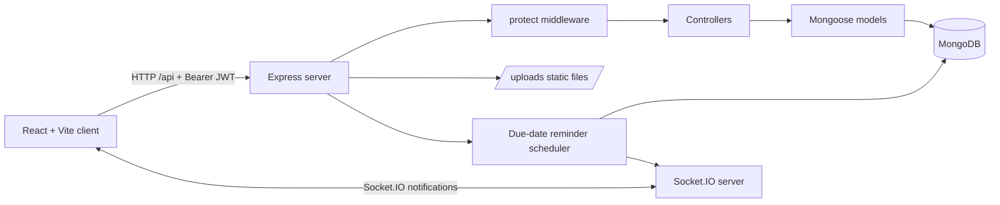
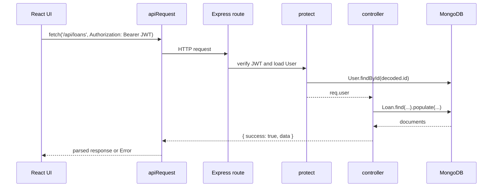

# BorrowBuddy architecture

This document describes the implementation currently in the repository. It distinguishes verified behavior from recommendations.

## System shape

BorrowBuddy is a React single-page application backed by an Express API and MongoDB. The browser stores the JWT and sends it as a bearer token. The server authenticates the token, applies ownership or membership checks in controllers, and reads or writes Mongoose documents.



## Runtime entry points

- [server/index.js](../server/index.js) creates the Express and HTTP servers, configures CORS, JSON parsing, routes, Socket.IO, static uploads, health checks, scheduler startup, and shutdown.
- [client/src/main.jsx](../client/src/main.jsx) mounts `<App />` inside React Strict Mode.
- [client/src/App.jsx](../client/src/App.jsx) is the current application shell. It contains the landing/auth views and the authenticated page sections rather than a separate router package.
- [server/Routes/](../server/Routes/) is the directory imported by `server/index.js`. A lowercase [server/routes/](../server/routes/) directory contains byte-identical route files in the current checkout; new changes should follow the uppercase path used by the entry point.

## Request lifecycle



`apiRequest` is implemented in [client/src/services/apiClient.js](../client/src/services/apiClient.js). It adds JSON and authorization headers, parses the response, and rejects unsuccessful responses. The backend returns `{ success: true, data }` for normal results and `{ success: false, message }` for handled errors.

## Backend layers

### Configuration and startup

[server/config/constants.js](../server/config/constants.js) reads `.env` and exposes port, host, CORS origins, JWT settings, body limit, upload directory, and reminder interval. [server/config/database.js](../server/config/database.js) calls `mongoose.connect(Constants.DBURL)`.

Startup waits for MongoDB before listening. It starts the reminder scheduler after the connection succeeds. `SIGINT`, `SIGTERM`, and an unexpected MongoDB disconnect close the HTTP server, Socket.IO, scheduler interval, and Mongoose connection.

### Routes and middleware

Every business route is protected by [server/middleware/authMiddleware.js](../server/middleware/authMiddleware.js) except registration, login, `/`, `/health`, and static `/uploads`. `protect` verifies `Constants.JWT_SECRET`, loads the user by the token subject, and assigns `req.user`.

[server/middleware/errorMiddleware.js](../server/middleware/errorMiddleware.js) handles unknown routes and maps Mongoose cast, duplicate-key, and validation errors. In development it includes a stack; in production it replaces 5xx details with `Internal server error`.

### Controllers and models

Controllers perform request validation, ownership checks, group membership checks, state transitions, notification creation, and Mongoose queries. Models in [server/model/](../server/model/) define validation, references, enums, and indexes. There is no separate repository layer or service layer for ordinary CRUD; the due-date scheduler is the main service module.

### Real-time events

[server/config/socket.js](../server/config/socket.js) stores the Socket.IO server and emits to `user:<userId>` rooms. Socket connections must present a valid JWT in `socket.handshake.auth.token`. Socket events complement, but do not replace, the persisted notification API.

## Frontend layers

- `App.jsx` owns authentication state, page selection, group/invitation/loan/notification loading, and major application handlers.
- Reusable group and inventory UI is in [client/src/components/](../client/src/components/).
- `BorrowBuddyProvider` in [client/src/context/BorrowBuddyContext.jsx](../client/src/context/BorrowBuddyContext.jsx) supplies inventory and loan actions to Inventory components.
- CSS is plain component and application CSS. There is no routing library, Redux store, CSS-in-JS library, or UI component package.
- Socket.IO client support is present in `App.jsx` for authenticated real-time updates.

## Data and ownership boundaries

The API derives identity from `req.user._id`; client-provided user IDs are not used for ownership decisions. Loan history uses:

```js
{ $or: [{ borrowerId: req.user._id }, { lenderId: req.user._id }] }
```

Notification reads use `recipientId: req.user._id`. Items use visibility queries based on ownership and group sharing. Group operations distinguish owner, manager, and ordinary member permissions.

## Verified limitations and maintenance notes

- There is no client-side router package; page navigation is state-based in `App.jsx`.
- There is no production job queue or distributed scheduler lock. The reminder service has MongoDB reminder-log claims and dedupe keys, but deployments should avoid running uncoordinated duplicate server instances unless that behavior is validated.
- The current test suite uses Node test stubs and Vitest/jsdom tests. It does not provision an isolated MongoDB instance or execute the complete HTTP workflow against a real database.
- `server/utils/itemVisibility.js` still checks the legacy invitation field `inviteeId`, while [server/model/invitation.js](../server/model/invitation.js) defines `invitedUserId`. This is a real compatibility gap for accepted-invitation visibility synchronization and should be corrected in application work, not hidden in documentation.
