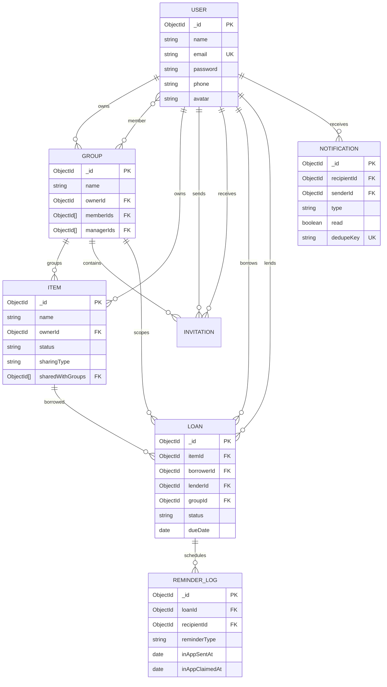

# BorrowBuddy database guide

BorrowBuddy uses MongoDB through Mongoose. Each model is registered with `mongoose.models.X || mongoose.model(...)`, which prevents duplicate model registration during development reloads.

## Entity relationships

## User

Source: [server/model/user.js](../server/model/user.js).

| Field | Type | Rules |
|---|---|---|
| `name` | String | Required, trimmed, maximum 50 characters |
| `email` | String | Required, lowercase, trimmed, regex validated, unique |
| `password` | String | Required, minimum 6 characters, `select: false`; hashed by bcryptjs pre-save hook |
| `phone` | String | Optional, default empty, trimmed |
| `avatar` | String | Optional, default empty |
| timestamps | Date | Mongoose `createdAt` and `updatedAt` |

`matchPassword` compares a submitted password using bcryptjs. Controllers intentionally return public fields and a JWT, not the stored password.

## Group

Source: [server/model/group.js](../server/model/group.js).

`name` is required, trimmed, and limited to 100 characters. `description` is optional, trimmed, and limited to 150 characters. `categories`, `image`, `memberIds`, and `managerIds` default to empty values. `ownerId` is a required User reference. Indexes exist on `ownerId` and `memberIds`.

The owner is inserted into `memberIds` and `managerIds` at creation. Authorization is enforced in controllers, not by MongoDB alone.

## BorrowableItem

Source: [server/model/borrowableItem.js](../server/model/borrowableItem.js).

| Field | Type | Rules |
|---|---|---|
| `groupId` | ObjectId → Group | Optional, indexed |
| `name` | String | Required, trimmed, max 100 |
| `category` | String | Required, trimmed, default `General`, indexed |
| `description` | String | Optional, trimmed |
| `status` | String | `available`, `requested`, `booked`, `borrowed`, `maintenance`, or `retired`; indexed |
| `ownerId` | ObjectId → User | Required, indexed |
| `imageUrl` | String | Defaults to empty |
| `sharingType` | String | `all` or `selected`, default `all` |
| `sharedWithGroups` | ObjectId[] → Group | Selected visibility groups |

There is a compound index on `{ sharingType, sharedWithGroups, ownerId }`. The controller prevents deleting items with requested, booked, or active loans.

## Invitation

Source: [server/model/invitation.js](../server/model/invitation.js).

`groupId`, `invitedBy`, and `invitedUserId` are required User/Group references. `requestedBy` is used for member requests. `requestType` is `owner_invitation` or `member_request`; `status` is `pending`, `accepted`, `rejected`, or `cancelled`. `message` defaults to empty.

The unique partial index `{ groupId: 1, invitedUserId: 1 }` applies only while `status: "pending"`, preventing duplicate pending invitations.

## Loan

Source: [server/model/loan.js](../server/model/loan.js).

References: optional `groupId`, required `itemId`, required `borrowerId`, and required `lenderId`. Dates include `checkoutDate` (default now), optional `dueDate`, optional `returnDate`; `durationDays` has a minimum of 1. `returnNote` is limited to 500 characters.

Loan status is one of:

`requested` → `active` (approval), with `booked` and activation paths also supported by the controller → `returned`.

Rejected and cancelled are terminal application states. Status is indexed. Borrower/lender/item/group references are indexed where defined. The current schema does not define a `cancelled` loan route; cancellation is handled by existing group/invitation behavior rather than a general loan endpoint.

## Notification

Source: [server/model/notification.js](../server/model/notification.js).

`recipientId` is required and indexed. `senderId` is optional. `type` is constrained to the application notification types, including `due_date_reminder`. `read` defaults to false and is indexed. `data` can reference a group, item, loan, invitation, requester, and reminder type. `dedupeKey` is unique and sparse, and excluded from normal query projection.

The due-date service writes keys shaped like `due-date:<loanId>:<reminderType>`, so one notification is retained per loan and reminder type.

## ReminderLog

Source: [server/model/reminderLog.js](../server/model/reminderLog.js).

Each log has required `loanId`, `recipientId`, and `reminderType`. `reminderType` is `one_day_before`, `due_today`, or `overdue`. `inAppClaimedAt` is a temporary processing lease and `inAppSentAt` records successful in-app persistence. The unique compound index `{ loanId: 1, reminderType: 1 }` prevents duplicate log rows.

## Query and deletion behavior

- Mongoose `populate` enriches user, group, item, loan, and invitation references for API responses.
- Loan history filters by borrower or lender from `req.user`, never by an arbitrary client user ID.
- Item visibility uses ownership, shared groups, and `sharingType` in [server/utils/itemVisibility.js](../server/utils/itemVisibility.js).
- Deleting a group clears group links from items and cancels pending invitations after loan restrictions pass.
- Deleting an item is blocked while unresolved loans exist.
- There are no migration scripts. Indexes are declared in schemas and are expected to be created by Mongoose/MongoDB deployment setup.

## Known data-integrity gap

`getGroupForMember` in [server/utils/itemVisibility.js](../server/utils/itemVisibility.js) checks legacy `inviteeId` when looking for an accepted invitation. The current invitation schema uses `invitedUserId`. This can prevent accepted-invitation membership synchronization for some visibility calls. Treat this as a verified issue to fix separately; the documentation does not represent it as correct behavior.
